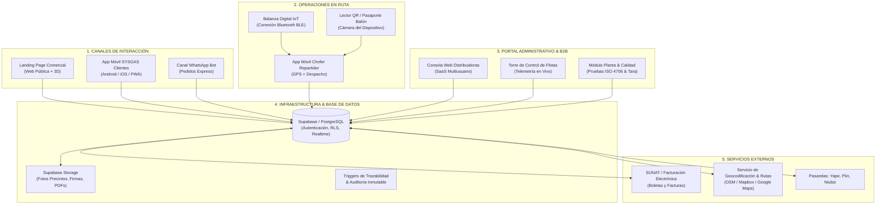
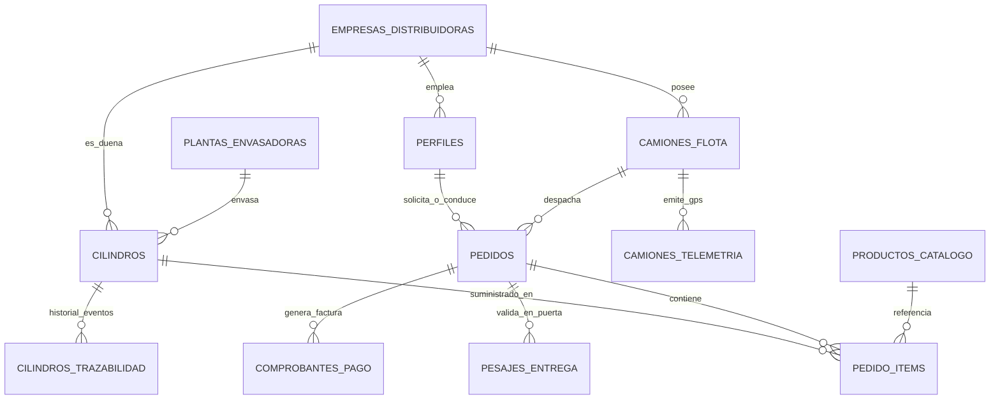
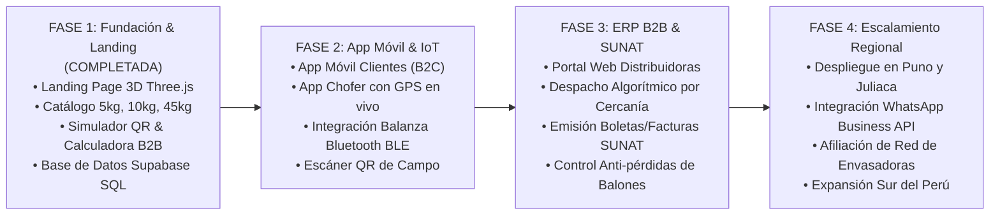

# Ecosistema Tecnológico SYSGAS · Documento Maestro de Sistema
> **Plataforma Integral de Gestión, Trazabilidad QR, IoT de Pesaje y Despacho de GLP**  
> *Enfoque Dual: Consumo Familiar y Comercial (B2C) + Plataforma SaaS para Distribuidoras Terceras (B2B)*  
> **Ámbito de Operación:** Puno, Perú (con proyección al Altiplano y Sur del País) · Versión 2026

---

## 1. Visión y Objetivo del Sistema

### 1.1 ¿Qué es SYSGAS?
**SYSGAS** es una plataforma tecnológica integral para la industria del Gas Licuado de Petróleo (GLP). Transforma el modelo tradicional, informal e incierto de venta de gas en un **ecosistema digital confiable, medible y auditable en tiempo real**.

El sistema resuelve las dos caras de la industria:
1. **Para el Usuario Común / Hogares (B2C):** Un aplicativo móvil y web donde puede pedir gas en 1 toque, rastrear la llegada del camión repartidor por GPS en calles de Puno, certificar que el balón tiene el **peso exacto mediante balanza digital en puerta**, y auditar el historial y seguridad del balón escaneando su código QR.
2. **Para Empresas Distribuidoras y Envasadoras Terceras (B2B SaaS):** Un sistema operativo completo para conectar sus camiones, controlar inventario cilindro por cilindro para **eliminar el extravío de balones vacíos**, despachar pedidos algorítmicamente al chofer más cercano, emitir facturación electrónica SUNAT en ruta y medir la rentabilidad operativa.

---

## 2. Problemática del Mercado vs. Solución SYSGAS

| Problema Tradicional del Gas en Puno | Solución Tecnológica SYSGAS |
| :--- | :--- |
| **Balones con faltante de peso (mermas/adulteración):** Los usuarios desconfían del contenido real de los balones comerciales. | **Pesaje digital obligatorio en puerta:** El chofer enlaza su balanza Bluetooth y la app valida la tara antes de autorizar el cobro. |
| **Pérdida de cilindros para distribuidoras:** Cada año se extravían o canjean cilindros por unidades en mal estado, causando pérdidas de miles de soles. | **Pasaporte QR Inmutable (Trazabilidad 1:1):** Registro estricto de qué chofer cargó el balón, a qué cliente se entregó y qué balón vacío se recuperó. |
| **Incertidumbre en la entrega:** Llamadas telefónicas donde el repartidor dice "ya voy llegando" sin hora exacta. | **Rastreo GPS en tiempo real:** El cliente ve la unidad desplazándose por las calles de Puno con cálculo de minutos de llegada. |
| **Falta de boleta y cobro solo en efectivo:** Informalidad en los pagos y dificultades para pequeñas empresas y restaurantes. | **Cobro multicanal y comprobante SUNAT:** Pagos con Yape, Plin, tarjeta POS o efectivo, con emisión instantánea de Boleta/Factura electrónica. |
| **Cilindros oxidados o con riesgo de fuga:** Balones antiguos sin pruebas hidrostáticas vigentes circulando en hogares. | **Certificación de Calidad ISO 4706:** Registro de inspección por ultrasonido, prueba a 14.7 bar y bloqueo automático de balones caducados. |

---

## 3. Arquitectura Global del Ecosistema

---

## 4. Componentes y Módulos del Sistema

### Módulo 1: Landing Page Comercial & Portal de Marca (Web)
* **Objetivo:** Canal institucional y comercial para Puno. Presenta la marca, ofrece el catálogo de balones, permite probar el escaneo de seguridad y capta distribuidores B2B.
* **Componentes clave ya construidos:**
  - **Hero 3D Inmersivo:** Balón de gas SYSGAS en Three.js con rotación 360°, válvula de latón y calcomanía institucional.
  - **Catálogo de Cilindros 3D:** Tarjetas interactivas con modelos a escala para **5 kg (Portátil)**, **10 kg (Familiar)** y **45 kg (Industrial Alargado)** con sus dimensiones reales.
  - **Simulador Interactivo de Pasaporte QR:** Lectura de certificados en tiempo real sin salir de la web.
  - **Calculadora B2B & Afiliación:** Estimador de ahorro en mermas y combustible para flotas de Puno, con contacto directo vía WhatsApp y acceso al LOGIN.
  - **Footer Institucional:** Estructurado según la referencia del Glorioso San Carlos de Puno, con sello giratorio, emblema central y animación sobria.

---

### Módulo 2: Aplicativo Móvil B2C (Para Usuarios Comunes)
* **Objetivo:** Permitir a cualquier familia o negocio en Puno pedir gas en segundos y recibirlo con máxima seguridad.
* **Funcionalidades:**
  1. **Pedido en 1 Toque (Express):** Selección de cilindro (5 kg, 10 kg, 45 kg), detección automática de ubicación GPS y guardado de direcciones favoritas.
  2. **Rastreo en Tiempo Real:** Visualización en el mapa del camión repartidor asignado, con placa del vehículo, nombre y foto del chofer, y tiempo estimado de llegada.
  3. **Certificado de Peso en Puerta:** El cliente visualiza en su pantalla la lectura exacta que arroja la balanza digital en el momento de la entrega (peso bruto − tara = peso neto de gas).
  4. **Pasaporte Digital del Balón:** Al escanear el QR físico del cilindro recibido, el cliente ve:
     - Fecha y lote de envasado en planta.
     - Certificado de prueba de presión a 14.7 bar.
     - Cumplimiento de norma ISO 4706.
  5. **Pagos Digitales Integrados:** Pago contra entrega en efectivo, Yape, Plin o tarjeta con emisión de Boleta Electrónica automática.

---

### Módulo 3: Aplicativo Móvil para Choferes y Repartidores
* **Objetivo:** Herramienta de trabajo en ruta para los conductores de las unidades distribuidoras.
* **Funcionalidades:**
  1. **Despacho Inteligente por Proximidad:** Notificación de nuevos pedidos asignados automáticamente según geocercas y cercanía al cliente en Puno.
  2. **Navegación GPS Optimizada:** Ruta punto a punto con indicaciones de tráfico local.
  3. **Conexión Bluetooth IoT con Balanza Digital:**
     - El chofer coloca el balón sobre la balanza digital portátil.
     - La app captura el peso vía Bluetooth BLE de forma obligatoria antes de permitir el cobro.
     - Si el peso neto está fuera de la tolerancia técnica (ej. menos de 9.95 kg en balón de 10 kg), el sistema bloquea la entrega para proteger al cliente.
  4. **Auditoría de Activos (Cero Pérdida de Balones):**
     - Escaneo del QR del balón entregado (sale del inventario del camión).
     - Escaneo del QR del balón vacío devuelto por el cliente (ingresa al camión como "retornado").
  5. **Liquidación Diaria:** Resumen de caja al final del turno: balones entregados por capacidad, dinero recaudado en efectivo vs. Yape/tarjetas, y cilindros vacíos en tolva.

---

### Módulo 4: Portal Web Administrativo & ERP B2B (SaaS para Distribuidoras Terceras)
* **Objetivo:** Plataforma de gestión integral para gerentes y operadores de distribuidoras de gas en Puno y el sur del país.
* **Funcionalidades:**
  1. **Torre de Control de Despacho (Live Fleet Map):**
     - Monitoreo en vivo de todas las unidades repartidoras sobre el mapa de Puno y Juliaca.
     - Estado de cada camión: *Disponible, En Ruta a Entrega, En Planta Cargando, Fuera de Servicio*.
  2. **Trazabilidad Integral de Cilindros:**
     - Base de datos de cada cilindro con número de serie único y QR.
     - Filtro por estado: *En Planta, En Camión #08, En Domicilio Cliente, En Mantenimiento*.
     - Alerta de balones retenidos o extraviados.
  3. **Gestión Comercial & Facturación SUNAT:**
     - Generación y envío automático de comprobantes de pago electrónicos (Boletas y Facturas con código QR y Hash SUNAT).
     - Historial de clientes frecuentes con hábitos de consumo y recordatorios de reposición de gas.
  4. **Métricas de Rentabilidad & Ahorro:**
     - Gráficos de balones distribuidos al día, índice de mermas recuperadas y ahorro de combustible por optimización de rutas.

---

### Módulo 5: Planta Envasadora, Control de Calidad & Trazabilidad ISO
* **Objetivo:** Certificar el producto desde el origen en la planta envasadora antes de salir a la red de distribución.
* **Funcionalidades:**
  1. **Control de Tara y Calibración:** Registro del peso del envase de acero vacío y calibración de básculas de llenado.
  2. **Módulo de Pruebas Hidrostáticas:**
     - Registro de pruebas a 14.7 bar durante 60 segundos por lote de balones.
     - Inspección por ultrasonido del cordón de soldadura circunferencial.
     - Registro de válvulas de alivio calibradas a 24 bar.
  3. **Asignación de Pasaporte QR:** Vinculación de la placa metálica QR con el registro digital inmutable del sistema.
  4. **Bloqueo Preventivo de Seguridad:** Si un cilindro cumple su fecha límite de recalificación según norma técnica o presenta golpes/deformaciones, el sistema lo inhabilita automáticamente para impedir su envasado o carga a camiones.

---

## 5. Arquitectura de Datos (Supabase / PostgreSQL)

El sistema cuenta con un esquema de base de datos relacional robusto implementado en `supabase/schema.sql`, compuesto por **13 tablas interconectadas**:

### Resumen de Tablas Maestras
1. `empresas_distribuidoras`: Datos de empresas B2B afiliadas (RUC, razón social, volumen mensual).
2. `plantas_envasadoras`: Sedes de envasado, tanques de almacenamiento y licencias Osinergmin.
3. `perfiles`: Usuarios del sistema sincronizados con `auth.users` (Super Admin, Dueño Empresa, Supervisor ISO, Chofer, Cliente).
4. `productos_catalogo`: Definición técnica de cilindros: 5 kg, 10 kg y 45 kg con dimensiones, taras y precios.
5. `camiones_flota`: Vehículos de reparto, chofer asignado, placa y capacidad en balones.
6. `camiones_telemetria`: Historial de coordenadas GPS, velocidad y altitud msnm (Puno ~3,812 msnm).
7. `cilindros`: Registro de cada balón físico, código QR, UUID inmutable, tara calibrada, precinto y estado.
8. `cilindros_trazabilidad`: Eventos inmutables de auditoría (llenado, prueba hidrostática, despacho, entrega).
9. `pedidos`: Cabecera de pedidos de gas con dirección en Puno, ticket, estado y montos.
10. `pedido_items`: Detalle de balones solicitados y cilindros asignados/recuperados.
11. `pesajes_entrega`: Registro de la balanza Bluetooth en la puerta del cliente (peso bruto, tara, peso neto, foto del precinto).
12. `comprobantes_pago`: Boletas y Facturas electrónicas con formato SUNAT.
13. `solicitudes_afiliacion`: Bandeja de distribuidores terceros interesados en afiliarse desde la web.

---

## 6. Integración de Hardware & IoT

1. **Balanzas Digitales Portátiles (Bluetooth BLE):**
   - Protocolo serial sobre BLE.
   - Envío continuo del valor de peso estabilizado al smartphone del chofer.
   - Encriptación de datos de pesaje para evitar manipulación manual del peso por parte del chofer.
2. **Placas QR de Alta Resistencia:**
   - Placas de aluminio remachadas al collarín protector del balón con código DataMatrix / QR grabado por láser.
   - Resistencia a intemperie, heladas del Altiplano, fricción en tolva de camión y lavado a presión.
3. **Sensores GPS de Flota:**
   - Telemetría dual: sensor GPS vehicular dedicado conectado a batería del camión + GPS asistido de la aplicación del chofer para respaldo.

---

## 7. Matriz de Roles y Niveles de Acceso (RBAC)

| Rol | Aplicación / Vista | Permisos Principales |
| :--- | :--- | :--- |
| **Super Admin SYSGAS** | Consola Global Master | Visión de todas las distribuidoras, auditoría de seguridad, gestión de licencias y catálogo general. |
| **Empresa Admin (B2B)** | ERP Web de Distribuidora | Gestión de su flota de camiones, registro de choferes, panel de pedidos, reportes de rentabilidad y facturación SUNAT. |
| **Supervisor de Calidad** | Módulo de Planta Web | Aprobación de pruebas hidrostáticas a 14.7 bar, certificación ISO 4706, control de lotes y bloqueo de cilindros averiados. |
| **Chofer Repartidor** | App Móvil Chofer | Recepción de pedidos asignados, navegación GPS, pesaje Bluetooth en puerta, escaneo QR de entrega/recuperación y cobro. |
| **Cliente / Consumidor** | App Móvil / Web Pública | Pedido express de balones, seguimiento del camión en vivo, verificación del certificado QR del balón y descarga de boleta. |

---

## 8. Roadmap de Desarrollo & Despliegue

### Cronograma de Entregables:
* **Fase 1 (Actual - Lista):**
  - Web pública operativa con identidad sólida, paleta verde jade institucional y modelos 3D de precisión técnica.
  - Base de datos en PostgreSQL / Supabase lista para recibir datos en producción.
* **Fase 2 (Próximo hito):**
  - Desarrollo de las aplicaciones móviles en React Native / Flutter (App Cliente y App Chofer).
  - Protocolo de conexión IoT con básculas digitales KERN / Torrey / compatibles por Bluetooth.
* **Fase 3:**
  - Panel administrativo web multi-tenant para empresas terceras.
  - Conexión con PSE / OSE para comprobantes de pago electrónicos de la SUNAT.
* **Fase 4:**
  - Campaña de lanzamiento en Puno y apertura para distribución regional masiva.

