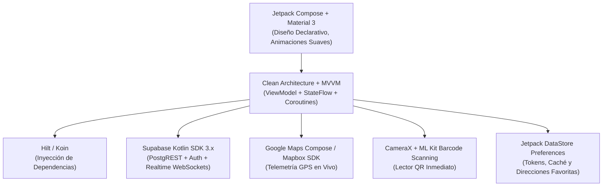
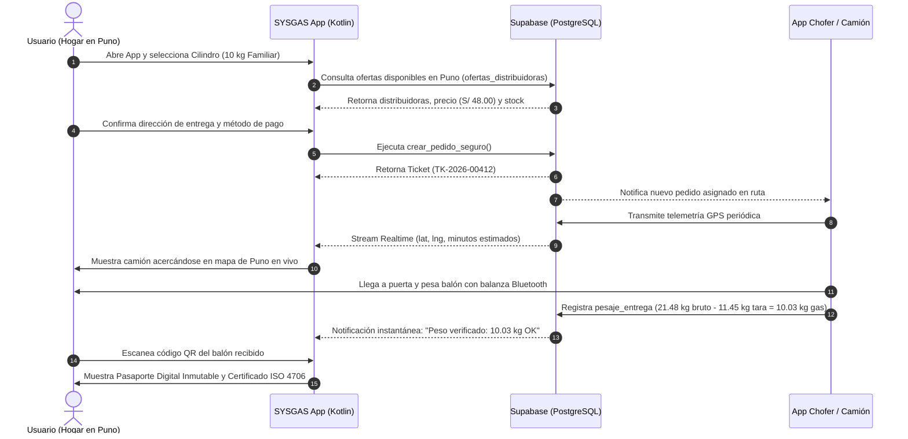

# Propuesta de Arquitectura y Mockups: Aplicativo Móvil SYSGAS (Android / Kotlin)
> **APK para Usuarios y Consumidores de GLP (B2C)**  
> *Plataforma Nativa Android con Jetpack Compose + Supabase Realtime + GPS en Vivo*  
> **Ámbito de Operación:** Puno y Juliaca, Perú · Versión 2026

---

## 1. Visión y Objetivos del Aplicativo Móvil

El aplicativo móvil para el usuario común tiene un objetivo central: **eliminar la incertidumbre y desconfianza al pedir gas**, permitiendo:
1. **Pedir en 1 Toque (Express):** Seleccionar el cilindro (5 kg, 10 kg, 45 kg), comparar precios de distribuidoras locales en Puno y confirmar con su dirección habitual en menos de 10 segundos.
2. **Rastreo GPS del Camión en Tiempo Real:** Ver el camión repartidor acercándose por las calles de Puno en un mapa dinámico con cálculo exacto de minutos de llegada.
3. **Verificación de Peso en Puerta:** Visualizar el pesaje digital que realiza el chofer con balanza Bluetooth antes de pagar.
4. **Escáner de Seguridad QR:** Comprobar el pasaporte digital del balón recibido (fecha de llenado, prueba hidrostática a 14.7 bar, lote de planta y sello de no fuga).
5. **Múltiples Métodos de Pago:** Integración de Yape, Plin, tarjeta POS contra entrega o efectivo, con comprobante electrónico automático.

---

## 2. Stack Tecnológico Recomendado (100% Kotlin Moderno)



| Capa / Módulo | Tecnología Seleccionada | Justificación Técnica |
| :--- | :--- | :--- |
| **Lenguaje** | **Kotlin 2.0+** | Lenguaje oficial de Android, seguro contra nulos (`null-safety`) y altamente expresivo. |
| **UI Framework** | **Jetpack Compose + Material 3** | UI 100% declarativa, sin XML. Rendimiento fluido a 60/120 fps y diseño responsive adaptable a cualquier smartphone Android. |
| **Arquitectura** | **Clean Architecture + MVVM + MVI** | Separación estricta entre presentación, dominio y datos. Facilita pruebas unitarias y mantenimiento modular. |
| **Backend & BD** | **Supabase Kotlin SDK (`supabase-kt`)** | Clientes nativos para Auth (OTP/Password), PostgREST (queries), Realtime (subscripción a GPS del camión) y Storage. |
| **Mapas & GPS** | **Google Maps Compose SDK / Mapbox** | Representación precisa de la topografía y calles de Puno (Calles céntricas, Jr. Arequipa, Barrio Porteño, etc.). |
| **Cámara & QR** | **CameraX + Google ML Kit** | Enfoque ultrarrápido (<150 ms) para escanear la placa QR del balón incluso en condiciones de poca luz. |
| **Inyección Dependencias** | **Koin 4.0 / Hilt** | Configuración ágil, ligera y optimizada para Android. |
| **Programación Asíncrona**| **Kotlin Coroutines + Flow** | Flujos reactivos de datos en tiempo real sin congelar la interfaz. |

---

## 3. Estructura de Paquetes del Proyecto Android

```text
com.sysgas.app/
│
├── core/                         # Utilidades y configuración transversal
│   ├── network/                  # Cliente Supabase, interceptores y manejo de errores
│   ├── designsystem/             # Tema Material 3, colores Jade SYSGAS, tipografías, botones
│   └── util/                     # Extensiones, formateador de moneda PEN, geocodificación
│
├── data/                         # Capa de Datos (Repositorios y DTOs)
│   ├── model/                    # Modelos de transferencia (OrderDto, CylinderDto, CompanyDto)
│   ├── repository/               # Implementación de OrderRepository, CatalogRepository, TrackingRepository
│   └── datasource/               # Supabase RemoteDataSource y DataStore LocalDataSource
│
├── domain/                       # Capa de Dominio (Reglas de Negocio Puras)
│   ├── model/                    # Entidades de dominio (Order, Cylinder, Location, Offer)
│   ├── repository/               # Interfaces de repositorios
│   └── usecase/                  # CreateOrderUseCase, TrackDriverLocationUseCase, GetPassportUseCase
│
└── presentation/                 # Capa de Presentación (Jetpack Compose)
    ├── navigation/               # NavHost, destinos (Home, Order, Tracking, Scanner, History)
    ├── home/                     # Pantalla Principal (Catálogo 3D/Cards, selector de cilindro)
    ├── order/                    # Pantalla de Checkout y Dirección en Puno
    ├── tracking/                 # Pantalla de Rastreo GPS en Tiempo Real del Camión
    ├── scanner/                  # Pantalla de Escaneo de Balón y Pasaporte Digital
    ├── weight/                   # Pantalla de Validación de Pesaje con Balanza Bluetooth
    └── history/                  # Historial de Pedidos y Repetición Express
```

---

## 4. Mapa de Flujo de la Aplicación (User Journey)



---

## 5. Mockups Visuales de Pantallas (Wireframes de Interfaz)

### Pantalla 1: Inicio / Catálogo Express (`HomeScreen.kt`)
Pantalla de aterrizaje al abrir la app. Muestra ubicación detectada en Puno, las 3 capacidades de cilindros y la distribuidora recomendada.

```text
┌────────────────────────────────────────────────────────┐
│  SYSGAS · Puno                              🔔  👤 (Foto)│
│  📍 Entregar en: Jr. Arequipa 520, Puno           [Cambiar]│
├────────────────────────────────────────────────────────┤
│  ⚡ PROMO PRIMER PEDIDO                                 │
│  ┌──────────────────────────────────────────────────┐  │
│  │  S/ 5.00 de descuento en tu primer pedido de GLP  │  │
│  │  Código: PUNOEXACTO · Válido en toda la ciudad    │  │
│  └──────────────────────────────────────────────────┘  │
│                                                        │
│  SELECCIONA TU CILINDRO                                │
│  ┌───────────────┐ ┌───────────────┐ ┌───────────────┐ │
│  │    [ 5 kg ]   │ │   [ 10 kg ]   │ │   [ 45 kg ]   │ │
│  │   Portátil    │ │   FAMILIAR    │ │  Industrial   │ │
│  │  38cm × 23cm  │ │  62cm × 30cm  │ │ 132cm × 38cm  │ │
│  │   S/ 28.50    │ │   S/ 48.00    │ │   S/ 185.00   │ │
│  │               │ │  ★ MÁS PEDIDO │ │               │ │
│  └───────────────┘ └───────────────┘ └───────────────┘ │
│                                                        │
│  DISTRIBUIDORA ASIGNADA PARA TU ZONA                   │
│  ┌──────────────────────────────────────────────────┐  │
│  │ 🏢 Gas del Altiplano S.A.C.     ⭐ 4.9 (420 envíos)│  │
│  │ ⏱️ Tiempo estimado: ~20 - 25 min                    │  │
│  │ ⚖️ Balanza digital Bluetooth en camión             │  │
│  │ 💰 Precio unitario: S/ 48.00 (Envío gratis)       │  │
│  └──────────────────────────────────────────────────┘  │
│                                                        │
│  [     PEDIR 10 KG AHORA (S/ 48.00)     ➔           ]  │
├────────────────────────────────────────────────────────┤
│   🏠 Inicio    │   📦 Mis Pedidos   │   📷 Escanear QR │
└────────────────────────────────────────────────────────┘
```

---

### Pantalla 2: Seguimiento GPS en Tiempo Real (`OrderTrackingScreen.kt`)
Se activa automáticamente una vez confirmado el pedido. Muestra el avance del camión por las calles de Puno.

```text
┌────────────────────────────────────────────────────────┐
│  ← Pedido #TK-2026-00412                       📞 Ayuda│
├────────────────────────────────────────────────────────┤
│                                                        │
│  ══════════════ [ VISTA DE MAPA EN VIVO ] ════════════ │
│                                                        │
│         [Calle Lima]                                   │
│              │                                         │
│              ▼                                         │
│         🚚 Camión #08 (Carlos M.)                      │
│              │                                         │
│              ▼ [Ruta trazada en verde jade]            │
│              │                                         │
│         📍 Tu Hogar (Jr. Arequipa 520)                 │
│                                                        │
│  ═════════════════════════════════════════════════════ │
│                                                        │
│  TARJETA DE ESTADO EN RUTA                             │
│  ┌──────────────────────────────────────────────────┐  │
│  │  🟢 EN CAMINO · Llegada estimada: ~6 minutos      │  │
│  │  ──────────────────────────────────────────────  │  │
│  │  👤 Repartidor: Carlos Mendoza Flores (Chofer)   │  │
│  │  🚚 Unidad: Camión Isuzu Elf · Placa: Z4A-892    │  │
│  │  Balón: 10 kg Familiar · Precinto: #PR-8902       │  │
│  │                                                  │  │
│  │  [ 📞 Llamar al Chofer ]   [ 💬 WhatsApp Ruta ]   │  │
│  └──────────────────────────────────────────────────┘  │
│                                                        │
│  GARANTÍA DE SEGURIDAD EN TU PUERTA                    │
│  ✓ El chofer colocará el balón en balanza antes de cobrar│
│  ✓ Peso bruto certificado: 21.45 kg ± 0.05 kg          │
└────────────────────────────────────────────────────────┘
```

---

### Pantalla 3: Verificación de Pesaje en Puerta (`CustomerWeightScreen.kt`)
Cuando el chofer llega y enciende la balanza digital, la app del cliente recibe la señal vía Supabase Realtime y despliega la confirmación:

```text
┌────────────────────────────────────────────────────────┐
│  ← Certificación de Peso en Puerta              SYSGAS │
├────────────────────────────────────────────────────────┤
│                                                        │
│         ⚖️ BALANZA DIGITAL CALIBRADA ACTIVA            │
│          Balanza Bluetooth: BLZ-KERN-PUNO-09           │
│                                                        │
│  ┌──────────────────────────────────────────────────┐  │
│  │                                                  │  │
│  │   PESO BRUTO MEDIDO:             21.48 kg        │  │
│  │   (-) TARA DEL CILINDRO:         11.45 kg        │  │
│  │   ═══════════════════════════════════════        │  │
│  │   GAS NETO RECIBIDO:             10.03 kg  ✓     │  │
│  │                                                  │  │
│  │   ESTADO: PESO EXACTO CERTIFICADO (Tolerancia OK)│  │
│  └──────────────────────────────────────────────────┘  │
│                                                        │
│  FOTO DEL PRECINTO TÉRMICO                             │
│  ┌────────────────────────┐  Precinto: #PR-8902        │
│  │ [ Miniatura Foto HD    │  Válvula de alivio dorada  │
│  │   con sello intacto ]  │  Sello hermético probado   │
│  └────────────────────────┘                            │
│                                                        │
│  TOTAL A PAGAR: S/ 48.00                               │
│  [  PAGAR CON YAPE  ]   [  PAGAR CON PLIN  ]   [ EFECTIVO ]
│                                                        │
│  [ ✓ CONFORME · RECIBIR BALÓN Y EMITIR BOLETA ]        │
└────────────────────────────────────────────────────────┘
```

---

### Pantalla 4: Lector de Pasaporte QR (`PassportQrScannerScreen.kt`)
El usuario puede apuntar la cámara a la placa remachada en el cuello del balón para conocer su historial completo:

```text
┌────────────────────────────────────────────────────────┐
│  ← Escanear Sello de Seguridad QR                      │
├────────────────────────────────────────────────────────┤
│                                                        │
│              ┌────────────────────────┐                │
│              │  ┌──────────────────┐  │                │
│              │  │                  │  │                │
│              │  │   [ ENFOCAR QR   │  │                │
│              │  │      DEL BALÓN ] │  │                │
│              │  │                  │  │                │
│              │  └──────────────────┘  │                │
│              └────────────────────────┘                │
│             ⚡ Escaneo instantáneo activo              │
│                                                        │
│  RESULTADO DE AUDITORÍA:                               │
│  ┌──────────────────────────────────────────────────┐  │
│  │ 🛡️ PASAPORTE DIGITAL VERIFICADO                   │  │
│  │ Código: SYS-2026-LPG-001 (GD-2024-00142)         │  │
│  │ Capacidad: 10 kg Familiar · Tara: 11.45 kg       │  │
│  │                                                  │  │
│  │ HISTORIAL DE SEGURIDAD AUDITABLE:                │  │
│  │ • 12/10/2026: Llenado en Planta Central Puno     │  │
│  │ • 14/10/2026: Prueba Hidrostática 14.7 bar OK    │  │
│  │ • 14/10/2026: Certificación Calidad ISO 4706     │  │
│  │ • 28/10/2026: Carga a Camión Z4A-892             │  │
│  │ • 28/10/2026: Entregado a Domicilio              │  │
│  └──────────────────────────────────────────────────┘  │
│                                                        │
│  [ DESCARGAR CERTIFICADO DIGITAL EN PDF ]              │
└────────────────────────────────────────────────────────┘
```

---

## 6. Implementación en Jetpack Compose (Código de Referencia)

### 6.1 Pantalla Principal (`HomeScreen.kt`)
```kotlin
package com.sysgas.app.presentation.home

import androidx.compose.foundation.layout.*
import androidx.compose.foundation.lazy.LazyRow
import androidx.compose.foundation.lazy.items
import androidx.compose.material3.*
import androidx.compose.runtime.*
import androidx.compose.ui.Modifier
import androidx.compose.ui.graphics.Color
import androidx.compose.ui.unit.dp
import com.sysgas.app.domain.model.CylinderProduct

@OptIn(ExperimentalMaterial3Api::class)
@Composable
fun HomeScreen(
    products: List<CylinderProduct>,
    selectedCapacity: String,
    onSelectCapacity: (String) -> Unit,
    onOrderClick: () -> Unit,
    modifier: Modifier = Modifier
) {
    Scaffold(
        topBar = {
            TopAppBar(
                title = { Text("SYSGAS · Puno", style = MaterialTheme.typography.titleLarge) },
                colors = TopAppBarDefaults.topAppBarColors(
                    containerColor = Color(0xFF062118),
                    titleContentColor = Color.White
                )
            )
        }
    ) { padding ->
        Column(
            modifier = modifier
                .fillMaxSize()
                .padding(padding)
                .padding(16.dp),
            verticalArrangement = Arrangement.spacedBy(16.dp)
        ) {
            Text(
                text = "Selecciona tu Cilindro",
                style = MaterialTheme.typography.titleMedium
            )

            LazyRow(horizontalArrangement = Arrangement.spacedBy(12.dp)) {
                items(products) { product ->
                    CylinderCard(
                        product = product,
                        isSelected = product.capacity == selectedCapacity,
                        onClick = { onSelectCapacity(product.capacity) }
                    )
                }
            }

            Spacer(modifier = Modifier.weight(1f))

            Button(
                onClick = onOrderClick,
                modifier = Modifier
                    .fillMaxWidth()
                    .height(56.dp),
                colors = ButtonDefaults.buttonColors(
                    containerColor = Color(0xFF00A878)
                )
            ) {
                Text(
                    text = "Pedir $selectedCapacity Ahora",
                    style = MaterialTheme.typography.titleMedium
                )
            }
        }
    }
}
```

### 6.2 Escucha en Tiempo Real del Camión (`OrderTrackingViewModel.kt`)
```kotlin
package com.sysgas.app.presentation.tracking

import androidx.lifecycle.ViewModel
import androidx.lifecycle.viewModelScope
import io.github.jan.supabase.SupabaseClient
import io.github.jan.supabase.realtime.PostgresAction
import io.github.jan.supabase.realtime.channel
import io.github.jan.supabase.realtime.postgresChangeFlow
import kotlinx.coroutines.flow.MutableStateFlow
import kotlinx.coroutines.flow.asStateFlow
import kotlinx.coroutines.launch

data class TruckLocationState(
    val latitude: Double = -15.8402,
    val longitude: Double = -70.0218,
    val etaMinutes: Int = 12,
    val driverName: String = "Carlos Mendoza",
    val plateNumber: String = "Z4A-892"
)

class OrderTrackingViewModel(
    private val supabase: SupabaseClient,
    private val orderId: String
) : ViewModel() {

    private val _locationState = MutableStateFlow(TruckLocationState())
    val locationState = _locationState.asStateFlow()

    init {
        subscribeToLiveDriverLocation()
    }

    private fun subscribeToLiveDriverLocation() {
        viewModelScope.launch {
            val channel = supabase.channel("tracking_$orderId")
            val changeFlow = channel.postgresChangeFlow<PostgresAction.Update>(schema = "public") {
                table = "ubicaciones_repartidores"
            }
            channel.subscribe()

            changeFlow.collect { action ->
                val record = action.record
                val lat = record["latitud"]?.toString()?.toDoubleOrNull() ?: return@collect
                val lng = record["longitud"]?.toString()?.toDoubleOrNull() ?: return@collect

                _locationState.value = _locationState.value.copy(
                    latitude = lat,
                    longitude = lng
                )
            }
        }
    }
}
```

---

## 7. Integración con la Base de Datos Existente

El aplicativo móvil en Kotlin reutilizará de forma inmediata el backend ya desarrollado en PostgreSQL / Supabase (`supabase/schema.sql`):

1. **`productos_catalogo`:** Obtención de los balones disponibles (5 kg, 10 kg, 45 kg) con sus dimensiones, peso neto y precios.
2. **`rpc('ofertas_distribuidoras')`:** Consulta de distribuidores autorizados en Puno con stock activo para cada capacidad.
3. **`rpc('crear_pedido_seguro')`:** Transacción atómica que valida stock, reserva la unidad y genera el ticket de pedido.
4. **`rpc('pasaporte_publico')`:** Lectura instantánea de la historia inmutable del cilindro a partir del código QR.
5. **`pesajes_entrega` & `comprobantes_pago`:** Recepción en tiempo real de la confirmación de la balanza digital y descarga del PDF de la boleta de venta.

---

## 8. Plan de Implementación por Fases (Roadmap del APK)

| Fase | Alcance y Entregables | Tiempo Estimado |
| :--- | :--- | :--- |
| **Fase 1: Estructura Base & Autenticación** | Configuración de proyecto Android en Kotlin 2.0, Jetpack Compose, navegación base, inyección de dependencias con Koin y autenticación Supabase (teléfono/correo). | **Semana 1** |
| **Fase 2: Catálogo & Pedido Express** | Implementación de `HomeScreen`, tarjetas de balones (5kg, 10kg, 45kg), selector de dirección con autocompletado en Puno y consumo del RPC `crear_pedido_seguro`. | **Semana 2** |
| **Fase 3: Mapas & Telemetría en Vivo** | Integración de Google Maps Compose, subscripción WebSockets a `ubicaciones_repartidores` para ver el camión moviéndose en tiempo real y cálculo de tiempo de llegada. | **Semana 3** |
| **Fase 4: Pesaje Bluetooth & Lector QR** | Módulo CameraX para lectura de pasaporte QR inmutable, vista de validación de peso en puerta y generación de APK final de prueba. | **Semana 4** |

